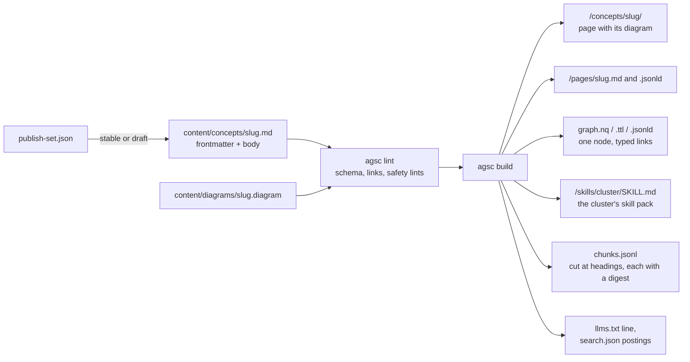

# How a card becomes a page, a graph node, a skill and a chunk

**Summary.** A card is one Markdown file in `content/concepts/`, with its diagram source
beside it in `content/diagrams/`. When it is published (its slug is in
`publish-set.json`), one run of `agsc build` turns it into a page for people, a node in
the knowledge graph, a part of its cluster's skill pack, chunks an agent can retrieve and
cite, a line of `/llms.txt` and entries in the search index — all from the same file, with
the same bytes on every machine. A draft card appears on none of them.

**Who this is for:** a contributor or a reader who wants to know what happens to a card.
**Read after:** the repository [README](../README.md).





The picture above is rendered from this Mermaid source; the source is the truth.

| Surface | What the card becomes there | Rule |
|---|---|---|
| Page | `/concepts/<slug>/`, readable without JavaScript, with its diagram compiled to SVG inside the page | AGSC-06-01, AGSC-01-07 |
| Machine views | `/pages/<slug>.md` (the source, normalised) and `/pages/<slug>.jsonld` | AGSC-06-02 |
| Graph | one node in the four graph views, its links typed, its sources and provenance attached | spec/05 |
| Skill | a part of the skill pack of each cluster it belongs to | AGSC-07-19 |
| Chunks | lines of `/chunks.jsonl`, cut at its headings, each with an identifier and a digest | AGSC-06-26 to AGSC-06-31 |
| Text and search | a line in `/llms.txt`, its text in `/llms-full.txt`, postings in `/search.json` | AGSC-06-13, AGSC-06-16 |
| Discovery | every file above that the discovery document names carries its SHA-256 digest | AGSC-06-08 |

A card held back as a draft is on no surface: no page, no graph node, no chunk, no line of
`llms.txt`, and no link to it from a published card (AGSC-06-29, AGSC-06-30).

```bash
agsc lint && agsc build   # from the repository root; the output is in www/
```
